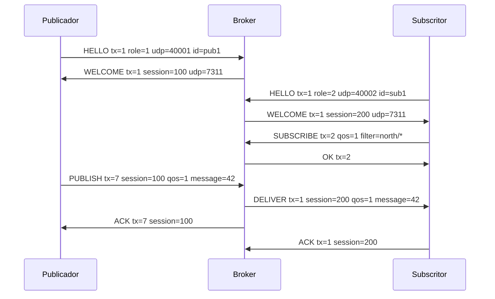

# Formato binário atual

Todos os inteiros são unsigned e big endian. Uma string usa comprimento de 2 bytes
seguido desse número de bytes UTF-8. Todos os campos abaixo são construídos e lidos
explicitamente em `protocol.py`; não se usa uma biblioteca de serialização.

## Cabeçalho comum

| Offset | Tamanho | Campo |
| --- | --- | --- |
| 0 | 2 | magic: bytes `CC` |
| 2 | 1 | versão: 1 |
| 3 | 1 | tipo de mensagem |
| 4 | 4 | comprimento do corpo em bytes |
| 8 | 8 | transmission_id |

O TCP pode dividir ou juntar mensagens: `pop_frame` retém dados incompletos e
consome uma mensagem de cada vez. No UDP, um datagrama contém exatamente uma
mensagem. O máximo total é 65507 bytes; valores maiores, versões/tipos inválidos,
truncamentos e bytes excedentes são rejeitados. Na prática, usar conteúdos pequenos
para não depender de fragmentação IP.

## Corpos

| Tipo | Valor | Campos, pela ordem de transmissão |
| --- | --- | --- |
| HELLO | 1 | role (1), porta UDP do cliente (2), client_id (string) |
| WELCOME | 2 | session_id (8), porta UDP do broker (2), broker_id (string) |
| SUBSCRIBE | 3 | qos (1), filtro (string) |
| UNSUBSCRIBE | 4 | filtro (string) |
| OK | 5 | vazio |
| ERROR | 6 | motivo (string) |
| BYE | 7 | vazio |
| PUBLISH | 16 | session_id (8), qos (1), message_id (8), tópico (string), tamanho do payload (4), payload |
| DELIVER | 17 | mesmos campos de PUBLISH |
| ACK | 18 | session_id (8) |

HELLO a BYE usam TCP. PUBLISH, DELIVER e ACK usam UDP. Roles: publisher=1,
subscriber=2, broker=3 (este último ainda não suportado pelo broker).
Respostas de controlo e ACKs repetem o transmission_id do pedido/envio confirmado.
O session_id é o da sessão do cliente em cada salto; o broker substitui-o ao
encaminhar uma publicação. O message_id e o tópico mantêm-se de ponta a ponta.

Exemplo de sequência, com valores ilustrativos:

```text
subscriber -- HELLO tx=1, role=2, udp=40001, id=sub1 --> broker
subscriber <- WELCOME tx=1, session=22, udp=7311 ----- broker
subscriber -- SUBSCRIBE tx=2, qos=2, north/* --------> broker
subscriber <- OK tx=2 ------------------------------ broker
publisher --- HELLO tx=1, role=1, udp=40002, id=pub1 -> broker
publisher <-- WELCOME tx=1, session=11, udp=7311 ----- broker
publisher --- PUBLISH tx=1, session=11, msg=1, qos=2 -> broker
publisher <-- ACK tx=1, session=11 ------------------ broker
subscriber <- DELIVER tx=1, session=22, msg=1, qos=2 - broker
subscriber -- ACK tx=1, session=22 -----------------> broker
```

O ACK e o DELIVER podem ser observados em qualquer ordem nos destinatários. Se o
último ACK se perder, o broker reenvia DELIVER com os mesmos IDs; em G2 o subscriber
confirma de novo sem escrever outra linha. Em G1 escreve novamente.
# SubControl e EventCast — versão 1, broker único

Implementação: `src/protocol.py` e `src/broker/broker.py`. Todos os inteiros são
sem sinal, em ordem de rede (big-endian). A codificação usa operações sobre bytes
e `int.to_bytes`/`int.from_bytes`; não usa JSON nem bibliotecas de serialização.
Os comprimentos contam bytes, não caracteres. O payload é opaco.

## Cabeçalho comum

Tabela 1 — cabeçalho fixo de 16 bytes, presente em todas as mensagens.

| Offset | Campo | Bytes | Significado |
| --- | --- | --- | --- |
| 0 | magic | 2 | ASCII `CC`, hexadecimal `43 43` |
| 2 | version | 1 | `1` |
| 3 | kind | 1 | Tipo da mensagem, Tabela 2 |
| 4 | body_length | 4 | Comprimento do corpo, sem estes 16 bytes |
| 8 | transmission_id | 8 | Identificador da operação TCP ou transmissão UDP neste salto |

O limite de uma mensagem é 65507 bytes, incluindo o cabeçalho (limite do payload
UDP em IPv4); `body_length <= 65491`. Mensagens grandes podem sofrer fragmentação
IP. Os futuros publicadores devem preferir payloads pequenos.

No TCP, o recetor acumula bytes até ter 16 bytes e depois o corpo completo.
Trata também várias mensagens no mesmo `recv`. Um cabeçalho inválido fecha essa
ligação; EOF elimina qualquer mensagem parcial. Um corpo de controlo inválido
gera ERROR. No UDP, um datagrama contém exatamente uma mensagem; truncagens,
bytes excedentes, tipos inválidos e corpos inválidos são descartados.

`text` significa `length:u16` seguido de `length` bytes UTF-8. IDs e tópicos não
podem conter espaços/caracteres de controlo. A estrutura de tópicos é a da
secção 3.4 do enunciado: três níveis numa publicação; filtros exatos ou prefixos
de um/dois níveis terminados em `/*`.

## Corpos das mensagens

Tabela 2 — tipos, transporte e campos em ordem de transmissão. Os tamanhos
`u8`, `u16`, `u32`, `u64` correspondem a 1, 2, 4 e 8 bytes.

| kind | Nome | Transporte/direção | Corpo |
| --- | --- | --- | --- |
| 1 | HELLO | TCP cliente → broker | `role:u8, data_port:u16, client_id:text` |
| 2 | WELCOME | TCP broker → cliente | `session_id:u64, data_port:u16, broker_id:text` |
| 3 | SUBSCRIBE | TCP subscritor → broker | `qos:u8, filter:text` |
| 4 | UNSUBSCRIBE | TCP subscritor → broker | `filter:text` |
| 5 | OK | TCP broker → cliente | vazio |
| 6 | ERROR | TCP broker → cliente | `reason:text` |
| 7 | BYE | TCP cliente → broker | vazio |
| 16 | PUBLISH | UDP publicador → broker | `session_id:u64, qos:u8, message_id:u64, topic:text, payload_length:u32, payload:bytes` |
| 17 | DELIVER | UDP broker → subscritor | mesmo formato de PUBLISH |
| 18 | ACK | UDP em resposta a PUBLISH/DELIVER | `session_id:u64` |

`role`: publicador=1, subscritor=2, broker=3 (reservado, ainda recusado).
`qos`: 1 ou 2. Uma resposta repete o `transmission_id` do pedido que confirma.
O `session_id` no plano de dados é sempre o da sessão do cliente naquele salto:
o broker substitui o do publicador pelo do subscritor ao construir DELIVER.

## Sessão e sequência mínima

1. O cliente abre e associa o seu socket UDP a uma porta local, sem enviar dados.
2. Liga por TCP ao `broker_control` da configuração e envia HELLO com essa porta.
3. Aguarda WELCOME. Aprende o identificador da sessão e a porta UDP do broker;
   usa o mesmo endereço IPv4 do broker da ligação TCP.
4. O subscritor envia SUBSCRIBE para cada filtro e aguarda OK. O publicador
   espera `start_after`, contado a partir do estabelecimento da sessão.
5. O publicador envia PUBLISH por UDP. O broker confirma com ACK e encaminha
   DELIVER a cada subscritor interessado. Cada um confirma o seu DELIVER.
6. BYE recebe OK e fecha a sessão; EOF TCP também remove a sessão e as pendências.

HELLO é obrigatório como primeira mensagem. O broker só aceita dados depois de
escrever WELCOME no socket TCP. IDs de clientes ativos e endpoints UDP ativos
têm de ser distintos. Cada sessão recebe um token aleatório não nulo de 64 bits.
Um datagrama só é aceite se token, papel, endereço e porta de origem coincidirem
com a sessão TCP. Não há suporte de NAT nem autenticação criptográfica.

Figura 1 — exemplo de uma publicação G1 e dos dois identificadores independentes.



Na Figura 1, o tópico é `north/station7/temperature` e o payload pode ser
`23.5`. O `message_id=42` viaja intacto. A futura linha de registo usa a cadeia
decimal `42` nas duas pontas; o publicador atribui IDs sem reutilização, mesmo
quando tem vários fluxos. O enunciado garante que dois publicadores não
partilham um tópico. O `transmission_id` de DELIVER é um contador por subscritor,
começa em 1 e é independente do contador do publicador. Retransmissões preservam
os dois IDs. Ao esgotar 64 bits, o broker fecha a sessão em vez de reutilizar um
ID que ainda possa ser confirmado. Os clientes devem igualmente evitar a volta
dos seus contadores. Não há persistência entre reinícios.

## Correspondência, QoS e fiabilidade

O broker mantém um dicionário `filter → qos` por subscritor. Repetir SUBSCRIBE
atualiza a garantia desse filtro. A pesquisa percorre os filtros e cria uma só
entrega por subscritor, com `min(qos_publicacao, max(qos_filtros_correspondentes))`.
UNSUBSCRIBE remove o filtro; remove também pendências cujos tópicos deixaram de
corresponder a qualquer filtro. Mensagens já em trânsito não podem ser retiradas
da rede. O QoS das entregas que continuam pendentes mantém o valor de quando
foram criadas; alterações de filtros aplicam-se às novas publicações.

Cada destinatário tem uma tabela `transmission_id → datagrama pendente`.
Há várias mensagens em trânsito e retransmissão seletiva: confirmar uma não
confirma as outras. O broker não espera por um subscritor para atender outro.
ACK ao publicador significa que o broker aceitou a publicação e criou as
entregas necessárias; não que todos os subscritores já a registaram. Sem
subscritores interessados, também confirma a publicação, mas não a retém para
subscrições futuras.

Em G1, cada PUBLISH recebido gera novamente as entregas, sem consultar estado
de duplicados. Em G2, o broker guarda `(topic, message_id)` durante a sessão do
publicador; confirma as repetições sem criar uma segunda entrega lógica.
Independentemente disso, DELIVER pode chegar repetido devido a perda de ACK.
**O subscritor ainda tem de implementar**:

- G1: registar cada DELIVER recebido, incluindo repetições.
- G2: registar só o primeiro `(topic, message_id)`; confirmar também repetições.
- Confirmar depois de processar/registar. Ao fechar a sessão TCP, deixar de
  entregar dados dessa sessão, incluindo datagramas que estavam no socket UDP.

G2 ponta a ponta não está concluído enquanto esse recetor não existir.

Tabela 3 — temporizadores e limites da implementação atual.

| Elemento | Valor | Efeito |
| --- | --- | --- |
| Retransmissão UDP | 0,25 s | Reenvia cada datagrama ainda sem ACK; sem limite de tentativas antes da expulsão |
| Poll de eventos | Até 0,05 s | Verifica terminação, expulsão e retransmissão |
| Expulsão | `evict_after` | Fecha TCP e descarta pendências se não houve progresso de ACK neste prazo |
| Duração | `duration` | Termina o broker e fecha sockets |
| Buffer de saída TCP | 1 MiB por cliente | Fecha a sessão que exceder o limite |

O prazo de expulsão começa quando a fila deixa de estar vazia e reinicia quando
um ACK válido remove uma pendência. ACK repetido, desconhecido ou de origem
errada não conta como progresso. Uma sessão sem entregas pendentes não é
expulsa por inatividade. Os temporizadores usam `time.monotonic()`; só os
futuros registos dos clientes usam tempo Unix em milissegundos.

As filas UDP e o conjunto de duplicados G2 vivem em memória, sem limite de
tamanho configurado. O ciclo dos temporizadores percorre as pendências;
cargas grandes podem aumentar o consumo de memória e o atraso dos timers.
Não se afirma uma janela limitada nem tolerância a reinícios do broker.

## Verificação executada

`python3 -m unittest discover -s tests -v`: 14 testes passaram em localhost.
Incluem uma rajada de 80 publicações com um subscritor a confirmar e outro sem
responder; perda simulada de ACK do publicador e do subscritor; pausa inferior
a `evict_after`; filtros sobrepostos; cancelamento; tráfego inválido;
fragmentação/coalescência TCP; terminação por duração e SIGTERM.

Estes testes não executam os futuros processos publisher/subscriber, não medem
perda real de rede e não usam a topologia CORE. Para a fase 2, ainda são
necessários testes de ponta a ponta e capturas nessas condições.
